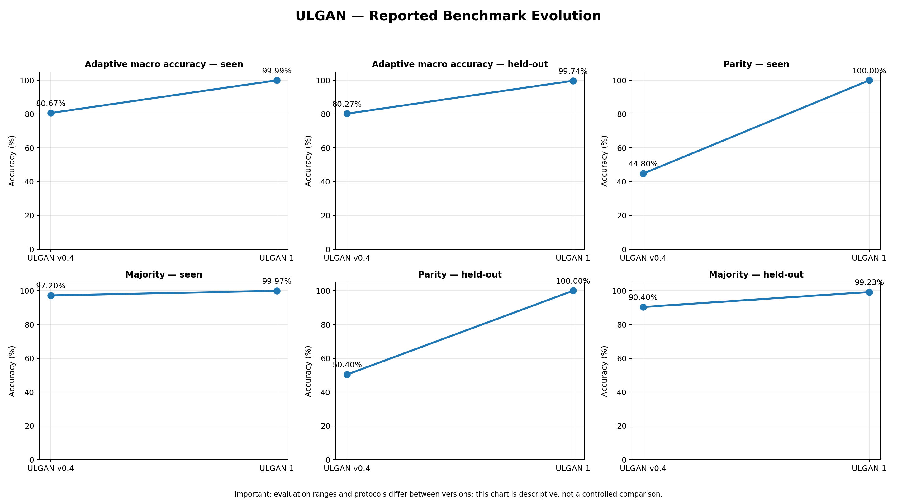

<div align="center">

# ULGAN 1

### Compact Adaptive Computation Research

**erlic AI · Independent AI Research**

[Hugging Face](https://github.com/erlic-AI/ulgan) ·
[Releases](https://github.com/erlic-AI/ulgan/releases)

**ULGAN 1.0.0 — First public release**

</div>

---

## Overview

ULGAN is an independent research project exploring adaptive internal
computation: a compact neural model learns when to stop thinking and
how much computation an input requires.

ULGAN 1 is the first multi-seed release of this research line. It
extends the v0.4 prototype with a larger recurrent architecture,
prefix supervision, density-aware majority processing and an
adaptive halting objective.

**Scope:** ULGAN 1 is a research model for three synthetic binary
sequence tasks. It is not a language model, chatbot or general-purpose
reasoning system.

## Version evolution

| Property | ULGAN v0.4 | ULGAN 1 |
|---|---:|---:|
| Parameters | 34,908 | 200,777 |
| Independent seeds | 1 | 3 |
| Maximum thinking steps | 8 | 12 |
| Training examples | 40,960 presented | 256,000 per seed |
| Adaptive seen-range macro accuracy | 80.67% | 99.99% |
| Adaptive held-out macro accuracy | 80.27% | 99.74% |
| Mean adaptive steps, seen | 2.11 | 1.93 |
| Mean adaptive steps, held-out | 2.06 | 2.13 |

**Comparison note:** v0.4 evaluated lengths 1–64 and 65–128.
ULGAN 1 evaluated lengths 1–128 and 129–256. Training settings,
sample counts and seed counts also differ. These are reported
version results, not a controlled apples-to-apples experiment.

## Benchmark evolution



### ULGAN 1 — adaptive inference

| Evaluation range | Macro accuracy | Parity | Majority | Last bit |
|---|---:|---:|---:|---:|
| Seen: 1–128 | **99.99%** | 100.00% | 99.97% | 100.00% |
| Held-out: 129–256 | **99.74%** | 100.00% | 99.23% | 100.00% |

### Adaptive vs fixed 12 steps

| Evaluation range | Adaptive macro | Fixed-12 macro |
|---|---:|---:|
| Seen: 1–128 | 99.99% | 72.27% |
| Held-out: 129–256 | 99.74% | 71.69% |

The fixed-step results show that later computation is not automatically
better. The adaptive policy is the intended inference method.

### Architecture and training

- Task-conditioned bidirectional GRU encoder.
- Recurrent latent thinking module.
- Learned adaptive halting controller.
- Prefix parity supervision.
- Density-aware feature for the majority task.
- 12 maximum thinking steps.
- Three independently trained seeds: 11, 23 and 42.
- 200,777 trainable parameters per model.

### Supported tasks

| Task | Definition |
|---|---|
| `parity` | 1 if the number of ones is odd |
| `majority` | 1 if strictly more than half the bits are 1 |
| `last_bit` | The final bit in the sequence |

## Installation

```bash
git clone https://github.com/erlic-AI/ulgan.git
cd ulgan
pip install -r requirements.txt
```

## Inference

```python
import torch
from src.ulgan.model import ULGAN, TASKS

model = ULGAN(
    hidden_size=96,
    embedding_size=24,
    task_embedding_size=12,
    max_think_steps=12,
    prefix_supervision=True,
    bidirectional=True
)

checkpoint = torch.load(
    "artifacts/ulgan_1_density_gated/ulgan_1_seed_11.pt",
    map_location="cpu",
    weights_only=False
)

# The training checkpoint contains its model state.
state = checkpoint.get(
    "model_state_dict",
    checkpoint.get("state_dict", checkpoint.get("model", checkpoint))
)
model.load_state_dict(state, strict=True)
model.eval()

bits = [1, 0, 1, 1, 0, 1]
prediction, steps, halt_probability = model.predict_one(
    bits, TASKS["parity"], threshold=0.95
)
print(prediction, steps, halt_probability)
```

For a ready-to-use standalone loader and all three clean state-dict
files, see the separate Hugging Face model repository.

## Repository contents

- `src/` — model implementation.
- `scripts/` — training and inference utilities.
- `tests/` — automated model tests.
- `configs/` — model configuration.
- `artifacts/` — checkpoints, metrics and experiment records.
- `research/` — protocols, reports and diagnostics.
- `assets/` — release benchmark visualizations.

The official ULGAN 1 checkpoints are in
`artifacts/ulgan_1_density_gated/`. Other folders preserve earlier
experiments and ablations; they are not interchangeable with the
official release checkpoints.

## Limitations

- The benchmark uses synthetic binary sequences only.
- Results do not establish general reasoning or language capability.
- Cross-version benchmark ranges are not identical.
- Difficult constructed examples can still expose errors.
- No real-world or safety-critical use is supported.

## Citation

```bibtex
@software{erlic_ai_ulgan_1,
  author = {{Erlic AI}},
  title = {ULGAN 1: Compact Adaptive Computation Research},
  version = {1.0.0},
  year = {2026},
  url = {https://github.com/erlic-AI/ulgan}
}
```

## License

Apache License 2.0. See the repository `LICENSE` file.
